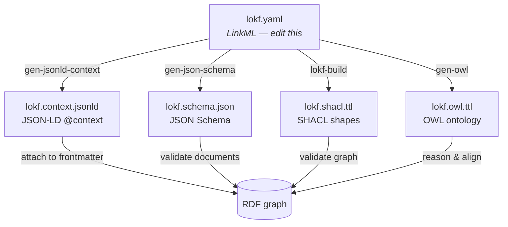

LinkML is the **single source of truth**.
[`lokf.yaml`](https://github.com/nicholsn/lokf/blob/main/lokf.yaml) defines the
classes, slots, enumerations, and their mappings to external vocabularies.
The repository builds the vocabulary artifacts below from that file.



| Artifact              | Generated by         | Purpose                                            |
|-----------------------|----------------------|----------------------------------------------------|
| `lokf.context.jsonld` | `gen-jsonld-context`* | Turns concept frontmatter into JSON-LD / RDF.      |
| `lokf.schema.json`    | `gen-json-schema`    | Validates concept frontmatter (JSON Schema).       |
| `lokf.shacl.ttl`      | `lokf-build`          | Validates the resulting RDF graph (SHACL).         |
| `lokf.owl.ttl`        | `gen-owl`            | Class/property ontology for reasoning & alignment. |
| `lokf.sql` | `gen-sqltables` | Relational schema with typed tables and foreign keys. |
| `src/lokf/datamodel.py` | `gen-python` | Typed Python bindings shipped in the package. |

\* The published context additionally aliases OKF's `type` field to the
JSON-LD `@type` keyword and `id` to `@id`, so that authoring in plain OKF
frontmatter is enough to produce correctly-typed Linked Data.

## Published copies

This site serves the schema and each artifact at its own path, copied from
the repository at build time:

| File | URL |
|------|-----|
| `lokf.yaml` | [/lokf.yaml](https://lokf.nolan-nichols.com/lokf.yaml) |
| `lokf.context.jsonld` | [/lokf.context.jsonld](https://lokf.nolan-nichols.com/lokf.context.jsonld) |
| `lokf.schema.json` | [/lokf.schema.json](https://lokf.nolan-nichols.com/lokf.schema.json) |
| `lokf.shacl.ttl` | [/lokf.shacl.ttl](https://lokf.nolan-nichols.com/lokf.shacl.ttl) |
| `lokf.owl.ttl` | [/lokf.owl.ttl](https://lokf.nolan-nichols.com/lokf.owl.ttl) |
| `lokf.sql` | [/lokf.sql](https://lokf.nolan-nichols.com/lokf.sql) |

A release tag holds the same files, pinned:
`https://raw.githubusercontent.com/nicholsn/lokf/<tag>/lokf.context.jsonld`.
New bundles use the site's `/lokf.context.jsonld` URL. The permanent identifier
`https://w3id.org/lokf/context.jsonld` remains reserved in the specification;
its redirect must be configured before clients can use it.

Because meaning lives in the model, adding a field or a type is a one-line
change in `lokf.yaml`; the context, schema, shapes, and ontology all
re-derive:

```bash
just build   # or: uv run lokf-build
```

The build normalizes serialization and CI checks that regeneration with the
locked toolchain reproduces the committed artifacts byte for byte.

## Static site exports

`lokf export` operates on a particular knowledge bundle. It always writes
`graph.json`, `datasets.jsonld`, `graph.nt`, and `concepts.jsonld`.
These four files are also the [registry producer contract](/toolkit/registry/).
Two options add files for static-site consumers:

| Option | Output | Contents |
|---|---|---|
| `--schema-docs` | `schema.json` | The browser reference for the resolved LinkML model, with classes, effective slots, enumerations, and datatypes. Use `lokf.schema.json` above for JSON Schema validation. |
| `--views lokf.views.yaml` | `views.json` | Compiled root concepts, related rows and return links for the declared navigation views. |

```sh
lokf export knowledge --out-dir build/export --schema-docs --views lokf.views.yaml
```

`--schema path/to/model.yaml` selects a domain vocabulary explicitly. The
exporter also honors the project's `[tool.lokf] schema` setting. New sites
request the relevant files at build time from the schema browser setting and
the presence of a view manifest. [Scaffold guide](/toolkit/scaffold/) · [Navigation views](/reference/declarative-views/)

## What the build does

The [`lokf-build`](/reference/api/) console script chains four steps: generate the
artifacts above, assemble `examples/acme-knowledge/` into a single
`KnowledgeBundle` document, validate it with `linkml-validate`, and project it
to N-Triples in `examples/`.
